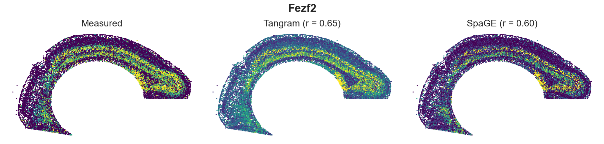
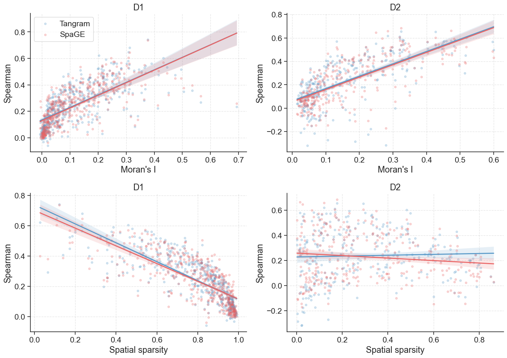
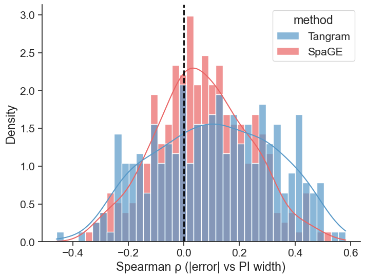

# Evaluating gene imputation in MERFISH spatial transcriptomics

Imaging-based spatial transcriptomics (MERFISH) measures gene expression in single cells in place, but only for a panel of a few hundred genes. Imputation methods fill in the missing genes using a single-cell RNA-seq reference. This project asks three questions:

1. **Which method imputes better:** Tangram or SpaGE, the two top performers in recent benchmarks?
2. **What makes a gene easy or hard to impute?**
3. **Can we trust the uncertainty estimates** that TISSUE attaches to imputed values?

Data: two MERFISH coronal sections of mouse cortex (D1: 19,441 cells x 464 shared genes; D2: 51,377 cells x 296 genes) and a 173,199-cell scRNA-seq reference.
Method: leave-one-gene-out cross-validation. Each measured gene is hidden in turn, predicted from the rest, and compared with its measured expression.

*LIDo PhD rotation project, UCL (2025), supervised by Dr Mathieu Bourdenx and Prof. Kenneth Harris.*

## Key findings

**Both methods recover real spatial patterns.** About 95% of genes are imputed significantly better than chance (cell-permutation test, FDR < 0.05) by both methods, and the two methods' significant gene sets overlap by ~97%.



*Fezf2, a layer 5 marker in cortex (D1): both methods recover the laminar band from the other genes alone.*

**Neither method is best everywhere.** SpaGE scores higher on most metrics in D1 (most clearly SSIM: 0.65 vs 0.53), while Tangram is significantly better on all four metrics in D2 (paired Wilcoxon over genes).

| | Tangram D1 | SpaGE D1 | Tangram D2 | SpaGE D2 |
|---|---|---|---|---|
| Pearson r | 0.314 | 0.315 | 0.294 | 0.262 |
| Spearman ρ | 0.246 | 0.241 | 0.237 | 0.228 |
| SSIM | 0.527 | 0.648 | 0.501 | 0.414 |
| JS divergence (lower = better) | 0.405 | 0.396 | 0.126 | 0.168 |
| Genes significant (FDR < 0.05) | 447 / 464 | 445 / 464 | 281 / 296 | 281 / 296 |

**Spatial structure, not sparsity, predicts how well a gene is imputed.** A gene's spatial autocorrelation (Moran's I) predicts imputation accuracy in both sections for both methods (r ≈ 0.67-0.72). Sparsity is strongly predictive in D1 (r ≈ −0.75) but not in D2, where sparsity and spatial structure are decoupled.



**TISSUE's uncertainty barely tracks real error.** Per gene, the correlation between absolute error and prediction-interval width averages just 0.06 for SpaGE and 0.11 for Tangram (D2). The intervals are most reliable for abundant genes and least reliable for sparse ones, which are exactly the genes where uncertainty matters most.



## Repository layout

```
notebooks/                 01-04: the analysis, in order (thin: settings, function calls, figures)
src/spatial_imputation/    reusable code imported by the notebooks and scripts
scripts/                   headless runner for the slow imputation step
tests/                     unit tests (metrics, statistics, preprocessing)
results/                   per-gene metrics and significant gene lists
docs/figures/              figures shown in this README
data/                      inputs and intermediate files (not tracked, see DATA.md)
```

| Notebook | What it does | Outputs |
|---|---|---|
| [`01_data_and_preprocessing`](notebooks/01_data_and_preprocessing.ipynb) | Cortex filter, sequencing depth, log-normalisation, shared genes, sparsity | processed AnnData pairs |
| [`02_loo_imputation`](notebooks/02_loo_imputation.ipynb) | Leave-one-gene-out predictions (Tangram cluster mode, SpaGE) | prediction matrices |
| [`03_imputation_benchmark`](notebooks/03_imputation_benchmark.ipynb) | Six per-gene metrics, permutation significance, method and dataset comparisons, Moran's I | `results/gene_metrics.csv`, `results/significant_genes/` |
| [`04_uncertainty_calibration`](notebooks/04_uncertainty_calibration.ipynb) | TISSUE conformal prediction intervals; does uncertainty track error? | figures |

Notebooks 03 and 04 are shown with their outputs. 01 and 02 are the slow upstream steps (hours of GPU/CPU time for Tangram); their outputs are cached in `data/`.

| Module | Contents |
|---|---|
| `config` | data paths (`SGI_DATA_DIR`), dataset definitions, cortex-mask parameters |
| `data` | loading, cortex filter, preprocessing, sparsity, loading predictions |
| `imputation` | Tangram / SpaGE wrappers and the leave-one-gene-out loop |
| `metrics` | Pearson, Spearman, RMSE, cosine, Jensen-Shannon, SSIM; score-vs-sparsity AUC |
| `stats` | vectorised permutation test with BH-FDR, Wilcoxon / Mann-Whitney comparisons, vectorised Moran's I |
| `uncertainty` | TISSUE calibration, error-vs-uncertainty reliability, quartile analysis |
| `plotting` | all figures |

## Running it

```bash
conda env create -f environment.yml        # installs this package + Tangram / TISSUE
conda activate spatial_imputation
pytest                                     # unit tests, no data needed

python scripts/run_loo_imputation.py --dataset d1 --method tangram   # slow imputation step, headless
jupyter lab notebooks/                                                 # then run 03 and 04
```

Notebook 03 and the tests need only the core scientific Python stack. 01, 02 and 04 also need the `impute` extras (`tangram-sc`, `tissue-sc`, `squidpy`, `torch`). The data are not public and are not included; [DATA.md](DATA.md) describes the files and what other datasets are compatible.

## Reproducibility and caveats

- The refactored code reproduces the original analysis: identical per-gene metrics and test statistics, and identical significant-gene lists for all four conditions. The permutation test is seeded and vectorised.
- **Double normalisation of D2.** The D2 spatial file is already log-normalised, and preprocessing normalises it again (as in the original analysis). Correlation-based metrics are largely unaffected; RMSE is not comparable across datasets. To change it, pass `normalize=False` for D2.
- **Sequencing depth.** D2 has 1,736 ± 1,153 counts per cell vs 288 ± 207 for D1 (`obs` count columns). An earlier version of the report quoted 454 ± 55 for D2, which was a sum of log-normalised values.
- The cortex mask is an ellipse tuned by eye per section (`config.DATASETS`), not an anatomical annotation.
- SSIM is the global (non-windowed) form on max-scaled vectors.
- TISSUE's calibration grouping (k-means) is not seeded, so uncertainty statistics vary slightly between runs.

## References

- Biancalani et al. (2021) Deep learning and alignment of spatially resolved single-cell transcriptomes with Tangram. *Nature Methods* 18, 1352-1362.
- Abdelaal et al. (2020) SpaGE: Spatial Gene Enhancement using scRNA-seq. *Nucleic Acids Research* 48, e107.
- Sun et al. (2024) TISSUE: uncertainty-calibrated prediction of single-cell spatial transcriptomics improves downstream analyses. *Nature Methods* 21, 444-454.
- Li et al. (2022) Benchmarking spatial and single-cell transcriptomics integration methods for transcript distribution prediction and cell type deconvolution. *Nature Methods* 19, 662-670.

The original exploratory notebooks are preserved at git tag [`pre-refactor`](../../tree/pre-refactor).
